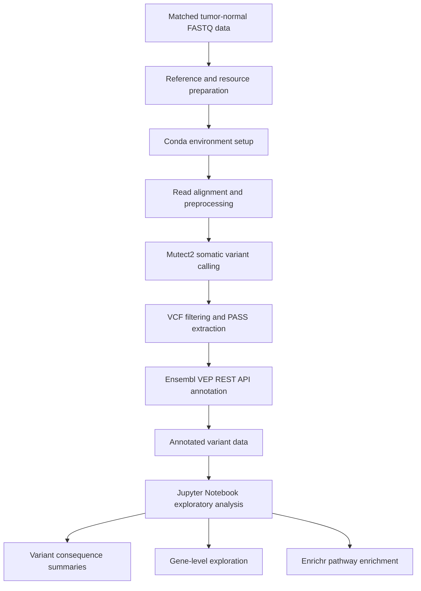

# Storage-Optimized Somatic Whole Exome Sequencing Pipeline (SWES)

A modular bioinformatics pipeline for matched tumor-normal whole-exome sequencing (WES), somatic variant calling, functional annotation, and exploratory pathway analysis. Designed for resource-constrained local environments using Ubuntu on Windows Subsystem for Linux 2 (WSL2).

**Author:** Jaydeep Desai  
**Domain:** Cancer genomics · Bioinformatics · Pipeline engineering  
**Primary variant caller:** GATK4 Mutect2  
**Functional annotation:** Ensembl Variant Effect Predictor (VEP) REST API  
**Downstream analysis:** Python, Jupyter Notebook, and Enrichr

> **Important scope limitation:** The documented Mutect2 analysis was restricted to chromosomes 6 and 17 and produced 272 reported `PASS` variants. These results represent the restricted analysis, not a complete exome-wide variant catalogue. The reference genome assembly and several upstream processing details remain unverified.

---

## Table of Contents

- [1. Project Overview](#1-project-overview)
- [2. Scientific Background](#2-scientific-background)
- [3. Project Objectives](#3-project-objectives)
- [4. Pipeline Architecture](#4-pipeline-architecture)
- [5. Dataset and Reference Resources](#5-dataset-and-reference-resources)
- [6. Execution Environment and Dependencies](#6-execution-environment-and-dependencies)
- [7. Workflow](#7-workflow)
  - [7.1 Reference Preparation](#71-reference-preparation)
  - [7.2 Environment Setup](#72-environment-setup)
  - [7.3 Alignment and Preprocessing](#73-alignment-and-preprocessing)
  - [7.4 Somatic Variant Calling](#74-somatic-variant-calling)
  - [7.5 Variant Extraction and Annotation](#75-variant-extraction-and-annotation)
  - [7.6 Exploratory Data Analysis](#76-exploratory-data-analysis)
  - [7.7 Pathway Enrichment](#77-pathway-enrichment)
- [8. Engineering Design](#8-engineering-design)
- [9. Reported Execution Results](#9-reported-execution-results)
- [10. Repository Structure](#10-repository-structure)
- [11. Reproducibility and Validation](#11-reproducibility-and-validation)
- [12. Known Limitations](#12-known-limitations)
- [13. Future Improvements](#13-future-improvements)
- [14. References and Documentation](#14-references-and-documentation)
- [15. Conclusion](#15-conclusion)

---

## 1. Project Overview

Somatic mutations contribute to cancer development, progression, and differences in cellular behavior. Whole-exome sequencing enables the investigation of genetic alterations within protein-coding regions of the genome. Comparing tumor sequencing data with a matched normal sample helps distinguish candidate somatic alterations from variants that may be inherited or present in the normal sample.

The Storage-Optimized Somatic WES Pipeline (SWES) implements a computational workflow for processing matched tumor-normal sequencing data associated with the HCC1395 breast cancer cell-line system.

The pipeline combines sequence alignment, alignment preprocessing, somatic variant calling, functional annotation, and exploratory biological analysis. Its engineering design addresses practical challenges encountered when running bioinformatics software on local hardware, particularly under Windows Subsystem for Linux 2 (WSL2).

The project has two main objectives:

1. **Biological analysis:** Identify candidate somatic single-nucleotide variants (SNVs) and insertions/deletions (indels), annotate their predicted functional consequences, and explore gene-level patterns and pathway enrichment.
2. **Pipeline engineering:** Organize the workflow into modular scripts, isolate software dependencies, reduce unnecessary intermediate files where supported by the implementation, and improve recovery from interrupted stages and external API failures.

This project is intended for research and exploratory analysis. It has not been established as a clinically validated diagnostic pipeline.

## 2. Scientific Background

### 2.1 Matched tumor-normal sequencing

Tumor samples may contain acquired somatic mutations alongside germline variants and technical artifacts. Analyzing tumor DNA alongside a matched normal sample provides additional evidence for distinguishing candidate somatic variants.

SWES uses GATK4 Mutect2 for tumor-normal somatic variant calling. Mutect2 evaluates sequencing evidence to identify candidate somatic SNVs and indels.

Matched-normal analysis does not eliminate every false positive. Sequencing artifacts, contamination, low coverage, mapping errors, sample mismatches, and other technical issues can affect the results. Appropriate filtering, quality control, and validation remain essential.

### 2.2 Resource-constrained bioinformatics

WES workflows can generate large alignment files and require substantial memory, storage, and computational time. Unnecessary intermediate files, dependency conflicts, and poorly validated restart mechanisms can make local execution difficult.

SWES addresses these challenges through modular Bash scripts, isolated Conda environments, chromosome-restricted resources, native Linux utilities for selected operations, and a Python annotation client designed to tolerate transient API failures.

## 3. Project Objectives

The primary objectives are to:

- Process matched tumor-normal WES data.
- Prepare reference genome resources for variant calling.
- Align sequencing reads and process alignment files.
- Identify candidate somatic variants using GATK4 Mutect2.
- Annotate variant consequences using the Ensembl VEP REST API.
- Summarize variant consequences and predicted impact categories.
- Explore frequently mutated genes.
- Perform pathway enrichment using Enrichr and KEGG gene sets.
- Improve execution reliability on a local WSL2 environment.
- Maintain a traceable record of data, tools, parameters, outputs, and limitations.

## 4. Pipeline Architecture

The documented workflow consists of the following stages:



The diagram represents the overall documented workflow. Exact commands and successful execution of some upstream stages require confirmation from their original scripts and logs.

### Workflow summary

| Stage | Script or artifact | Purpose |
|---|---|---|
| Reference preparation | `scripts/01_3_setup_reference.sh` | Prepare reference genome resources and indexes |
| Resource preparation | `scripts/01_4_slice_resources.sh` | Prepare chromosome-restricted resources |
| Environment setup | `scripts/02_setup_environments.sh` | Configure isolated Conda environments |
| Alignment and preprocessing | `scripts/03_align_and_preprocess.sh` | Align and process sequencing reads |
| Somatic variant calling | `scripts/04_somatic_variant_calling.sh` | Call variants on chromosomes 6 and 17 |
| Variant annotation | `scripts/05_annotate_variants.sh` | Extract `PASS` variants and annotate them |
| Annotation client | Embedded Python client | Handle VEP requests, retries, and fallback behavior |
| Exploratory analysis | `notebooks/06_Exploratory_Analysis.ipynb` | Analyze annotated variants and pathways |

The exact implementations of the reference-preparation, environment-setup, and alignment scripts are not fully recoverable from the current project evidence.

## 5. Dataset and Reference Resources

### 5.1 Sequencing dataset

The project uses matched tumor-normal whole-exome sequencing data associated with the HCC1395 breast cancer cell-line system.

The recorded processed alignment files are:

| File | Reported size | Role |
|---|---:|---|
| `Exome_Tumor.final.bam` | Approximately 663 MB | Tumor-sample alignment |
| `Exome_Norm.final.bam` | Approximately 515 MB | Normal-sample alignment |

The recorded Mutect2 configuration identifies the normal sample as `HCC1395BL_DNA`. Its relationship to the original downloaded sample must be confirmed using the source dataset metadata.

The following information remains to be recovered:

- Original FASTQ download URLs and accessions.
- Complete tumor and normal sample metadata.
- Sequencing platform and read layout.
- Exome capture kit and sequencing depth, if available.
- Reference genome assembly.
- Input file checksums and integrity-validation records.

### 5.2 Reference resources

| Resource | Purpose | Status |
|---|---|---|
| `ref_genome.fa` | Reference genome for alignment and variant calling | Assembly version unverified |
| `pon.chr6_17.vcf.gz` | Chromosome-restricted panel of normals | Source and compatibility require verification |
| `gnomad.chr6_17.vcf.gz` | Chromosome-restricted population germline resource | Release and assembly require verification |
| Reference indexes and dictionaries | Support alignment and variant processing | Exact filenames and versions require verification |

The FASTA, indexes, panel of normals, population germline resource, and variant annotation coordinates must use compatible genome assemblies and contig naming conventions.

For example, `chr6` and `6` can refer to the same chromosome under different naming conventions. Any conversion must be applied consistently and must not change the underlying coordinates or allele representation.

## 6. Execution Environment and Dependencies

### 6.1 Operating environment

The documented environment is Ubuntu running under Windows Subsystem for Linux 2.

Recorded system information:

- **Platform:** WSL2
- **Architecture:** `amd64`
- **Kernel:** `6.18.54.1-microsoft-standard-WSL2`

The exact Ubuntu release, hardware configuration, available memory, CPU allocation, and WSL storage settings remain to be documented.

### 6.2 Software stack

| Tool or library | Purpose |
|---|---|
| BWA-MEM | Sequence alignment |
| SAMtools | Alignment processing and BAM utilities |
| Picard | Alignment-processing utilities, where used |
| GATK4 Mutect2 | Somatic variant calling |
| GATK4 filtering utilities | Variant filtering, where implemented |
| Strelka2 | Alternative caller investigated during development |
| Conda | Dependency and environment management |
| Bash and Unix utilities | Workflow orchestration and file processing |
| Python | Annotation and downstream analysis |
| Pandas | Data manipulation |
| Matplotlib | Data visualization |
| Seaborn | Statistical visualization |
| Jupyter Notebook | Exploratory analysis |
| Ensembl VEP REST API | Functional variant annotation |
| Enrichr REST API | Gene-set and pathway enrichment |

Recorded versions:

- **GATK:** `4.6.1.0`
- **Strelka2:** `2.9.10`

Exact versions of the other tools and Python packages should be recovered from the original environment files or execution logs.

### 6.3 Conda environments

The project uses separate environments to reduce dependency conflicts:

| Environment | Intended purpose |
|---|---|
| `swes-core` | Core processing tools |
| `swes-gatk` | GATK-related tools |
| `swes-strelka` | Strelka2-related dependencies |
| `swes-py` | Python annotation and analysis dependencies |

The Strelka2 environment was configured or investigated, but the documented Strelka2 execution failed with a segmentation fault.

## 7. Workflow

### 7.1 Reference Preparation

The reference-preparation stage is intended to establish the genome resources required for alignment and somatic variant calling.

Typical reference preparation may include:

- Reference FASTA validation.
- FASTA indexing.
- Sequence dictionary creation.
- BWA index generation.
- Preparation or validation of the panel of normals.
- Preparation or validation of population germline resources.
- Chromosome-specific resource preparation.

The exact commands and resources used by `scripts/01_3_setup_reference.sh` and `scripts/01_4_slice_resources.sh` must be verified against their source code.

#### Chromosome restriction

The documented Mutect2 command includes:

```bash
-L chr6 -L chr17
```

This restricts the corresponding variant-calling traversal to chromosomes 6 and 17.

Resource slicing and calling-interval restriction are different operations. Reducing the size of a PoN does not, by itself, establish that variant calling was restricted. The actual calling arguments and input resources must be checked independently.

### 7.2 Environment Setup

The environment-setup stage uses Conda to isolate dependencies.

The intended benefits include:

- Reducing conflicts between incompatible packages.
- Separating Python and native bioinformatics dependencies.
- Making the software environment easier to recreate.
- Allowing different workflow stages to use their appropriate tools.

For long-term reproducibility, each environment should be documented with its package versions, channels, and installation source. A version-pinned environment specification is preferable to relying only on environment names.

### 7.3 Alignment and Preprocessing

The alignment stage is intended to transform sequencing reads into processed BAM files suitable for somatic variant calling.

The documented technology stack includes BWA-MEM, SAMtools, and Picard.

The earlier project description proposed connecting alignment and downstream processing through Unix pipes to reduce unnecessary intermediate SAM/BAM files. However, the exact implementation of `scripts/03_align_and_preprocess.sh` is not available in the recovered evidence. The precise command order and streaming behavior therefore remain unverified.

The exact BQSR procedure, including known-sites resources and recalibration commands, also requires verification.

The reported BAM file sizes document the presence of processed alignment outputs, but file size alone does not establish alignment quality, correct sample identity, or successful recalibration.

### 7.4 Somatic Variant Calling

The primary calling script is:

`scripts/04_somatic_variant_calling.sh`

The recovered implementation uses GATK4 Mutect2 for matched tumor-normal analysis and explicitly restricts calling to chromosomes 6 and 17.

The workflow uses reference and resource files, processed tumor and normal alignments, and chromosome-specific calling intervals.

#### Reported execution

| Metric | Reported value |
|---|---|
| Variant caller | GATK4 Mutect2 |
| GATK version | `4.6.1.0` |
| Calling scope | Chromosomes 6 and 17 |
| Reported regions processed | 944,168 |
| Approximate runtime | 19.2 minutes |
| Reported `PASS` variants | 272 |

These values reflect the recorded execution. The exact definition of the region count and the final filtering procedure should be verified against the original logs and script.

#### Interpretation

`PASS` is a VCF filtering status. It does not independently prove that a variant is biologically correct, cancer-driving, or clinically significant.

The final workflow should confirm that the variants passed the intended Mutect2 filtering process, including `FilterMutectCalls` where applicable, and that downstream annotation uses the correct filtered VCF.

#### Strelka2 evaluation

Strelka2 version `2.9.10` was investigated as an alternative caller. Its execution failed in the documented WSL2 environment with a segmentation fault and exit code `-11`.

The workflow subsequently used Mutect2.

The failure establishes that the attempted execution did not complete successfully. It does not establish that Strelka2 is universally incompatible with WSL2 or conclusively identify the underlying cause.

### 7.5 Variant Extraction and Annotation

The annotation stage is implemented in:

`scripts/05_annotate_variants.sh`

#### VCF extraction

The recovered script uses native Linux utilities, including `zcat` and `awk`, to extract `PASS` records from a compressed VCF.

This approach bypassed a problem with the Conda `bcftools` installation, which encountered a shared-library linkage failure involving `libgsl.so.25`.

The extraction procedure should preserve VCF headers, interpret the FILTER column correctly, and use the intended filtered VCF. The handling of multiallelic variants, indels, and missing values should also be validated.

#### Ensembl VEP REST API

The project uses the Ensembl Variant Effect Predictor REST API for functional annotation.

Documented endpoint:

`https://rest.ensembl.org/vep/human/region`

The Python annotation client is embedded in the annotation script.

VEP can provide transcript-aware consequence annotations and related information useful for variant prioritization. These predictions do not independently establish pathogenicity or clinical significance.

Correct annotation requires compatible genome assembly coordinates and appropriate chromosome and allele representations.

#### API resilience

During execution, the Ensembl API returned HTTP `503 Service Unavailable` and `500 Internal Server Error` responses.

The annotation client implements retry and exponential backoff behavior and includes an offline CSV fallback. The execution history also records that converting chromosome notation from `chr6` to `6` helped resolve API request failures.

These mechanisms improve resilience but do not guarantee complete annotation. The workflow should distinguish successful online annotation, fallback annotation, partial results, and failed requests.

### 7.6 Exploratory Data Analysis

The downstream notebook is:

`notebooks/06_Exploratory_Analysis.ipynb`

The recovered notebook contains four Python cells covering exploratory analysis and Enrichr API integration.

The documented analysis includes:

- Variant consequence summaries.
- Predicted impact categories.
- Gene-level mutation summaries.
- Visualizations using Matplotlib and Seaborn.
- Gene-set enrichment analysis.

#### Variant consequences

The notebook explores categories such as missense, synonymous, and frameshift variants, along with other consequences where present.

These categories describe predicted molecular effects. They are not interchangeable with clinical pathogenicity classifications.

Multiple transcript annotations can correspond to one genomic variant. The analysis should distinguish unique variants, annotation rows, and unique genes to avoid misleading counts.

#### Predicted impact

The notebook explores predicted VEP impact categories, including HIGH, MODERATE, and LOW.

These categories can support prioritization but do not independently establish that a variant drives cancer.

#### Gene-level analysis

The notebook includes a top-10 frequently mutated gene summary.

Frequency-based ranking identifies genes represented repeatedly in the annotation data. It does not establish that those genes are validated cancer drivers. Stronger driver claims require independent evidence and appropriate biological interpretation.

### 7.7 Pathway Enrichment

The notebook integrates the Enrichr REST API and uses the `KEGG_2021_Human` gene-set library.

The general workflow is to generate a gene list from annotated variants, submit it to Enrichr, retrieve enrichment results, and visualize selected pathways.

Pathway enrichment identifies gene sets overrepresented in an input list under a statistical model. It does not prove pathway activation, inhibition, or causality.

Interpretation depends on:

- Gene-list selection criteria.
- Identifier mapping and deduplication.
- Background assumptions.
- Gene-set library and version.
- Statistical significance thresholds.
- Multiple-testing correction.
- The genomic scope of the input variants.

Because the documented variant-calling analysis is restricted to chromosomes 6 and 17, pathway results may not represent the full exome. The notebook's exact ranking statistics and significance thresholds should be verified before drawing biological conclusions.

## 8. Engineering Design

### 8.1 Modular execution

The workflow is divided into scripts for reference preparation, environment setup, alignment, variant calling, and annotation. This separation makes stages easier to inspect and rerun.

### 8.2 Dependency isolation

Separate Conda environments reduce the risk of incompatible software dependencies interfering with each other.

### 8.3 Native utility fallback

Using `zcat` and `awk` for VCF extraction bypasses the specific `bcftools` linkage issue for that operation. It does not repair the underlying dependency problem.

### 8.4 Annotation fault tolerance

Retry logic, exponential backoff, and offline fallback behavior reduce dependence on uninterrupted availability of the Ensembl service.

### 8.5 Checkpointing and recovery

The project design describes checking existing outputs before executing expensive steps. However, file existence alone is not sufficient to establish that a previous run completed successfully.

Reliable checkpointing should validate output integrity, indexes, execution status, and relevant metadata before reusing an artifact.

### 8.6 Storage optimization

The project aims to reduce unnecessary intermediate files during alignment and processing. The claim of greater than 70% disk I/O reduction has not been verified against a documented baseline benchmark.

Disk I/O, peak temporary storage, total storage, memory consumption, and runtime are different measurements and should be evaluated separately.

## 9. Reported Execution Results

The currently recoverable execution evidence includes:

- Processed tumor and normal BAM files.
- Mutect2 execution restricted to chromosomes 6 and 17.
- A reported total of 944,168 regions processed in approximately 19.2 minutes.
- A reported output of 272 `PASS` variants.
- Strelka2 execution failure with exit code `-11`.
- `bcftools` shared-library linkage failure involving `libgsl.so.25`.
- Ensembl VEP API errors with HTTP status codes `500` and `503`.
- Successful use of native `zcat`/`awk` extraction as a workaround for the `bcftools` issue.
- A documented retry/fallback annotation strategy.

These observations describe the available execution record. They do not establish independent validation of all variants, complete annotation coverage, or full reproducibility from raw FASTQ data.

## 10. Repository Structure

The documented repository layout is:

```text
SWES/
├── scripts/
│   ├── 01_3_setup_reference.sh
│   ├── 01_4_slice_resources.sh
│   ├── 02_setup_environments.sh
│   ├── 03_align_and_preprocess.sh
│   ├── 04_somatic_variant_calling.sh
│   └── 05_annotate_variants.sh
├── notebooks/
│   └── 06_Exploratory_Analysis.ipynb
├── align/
├── calls/
├── fastq/
├── logs/
├── ref/
├── tmp/
├── .gitignore
└── README.md
```

This is the documented layout, not a verified listing of every file currently present in the repository.

The VEP client is documented as embedded in `scripts/05_annotate_variants.sh`. A separate `annotate_vep.py` file should only be listed as an independent repository file if it actually exists.

The `.gitignore` excludes generated data and variant files, including:

- `.vcf` and `.vcf.gz` files.
- `align/`
- `calls/`
- `fastq/`
- `logs/`
- `ref/`
- `tmp/`

This helps prevent large sequencing files and generated outputs from being committed accidentally. Documentation, source code, environment specifications, provenance manifests, and suitable test fixtures should remain under version control.

## 11. Reproducibility and Validation

The project has a modular script structure, isolated environments, and recorded execution outputs. Complete reproducibility requires the exact input data, reference assembly, resource versions, dependency specifications, and upstream execution details.

### Validation checklist

- [ ] Recover original tumor and normal FASTQ accessions and download sources.
- [ ] Confirm the tumor-normal sample pairing.
- [ ] Identify the reference genome assembly.
- [ ] Record reference FASTA checksums and index versions.
- [ ] Verify PoN and population germline resource compatibility.
- [ ] Recover the exact alignment and SAMtools processing commands.
- [ ] Verify BQSR resources and execution.
- [ ] Confirm the Mutect2 filtering procedure.
- [ ] Confirm that the 272 `PASS` records came from the intended filtered VCF.
- [ ] Validate VCF headers, indexes, and sample identities.
- [ ] Measure VEP annotation completeness and record fallback usage.
- [ ] Confirm notebook counting rules and enrichment statistics.
- [ ] Record exact software versions and Conda environment specifications.
- [ ] Validate outputs rather than relying solely on file existence.
- [ ] Benchmark storage and runtime before making quantitative optimization claims.

## 12. Known Limitations

### Restricted genomic scope

Variant calling was limited to chromosomes 6 and 17. The results cannot be generalized to the complete exome.

### Unverified reference assembly

The reference assembly and exact resource releases have not been conclusively established. Incompatible genome builds could invalidate downstream annotations or variant interpretation.

### Incomplete upstream execution record

The exact alignment, quality-control, and BQSR implementations are not available in the recovered evidence.

### Strelka2 execution failure

The attempted Strelka2 run failed with a segmentation fault. The workflow used Mutect2 instead.

### Dependency issue

The Conda `bcftools` installation encountered a `libgsl.so.25` linkage failure. Native utilities were used for VCF extraction.

### External API dependency

VEP requests encountered HTTP 500 and 503 responses. Retry and fallback mechanisms improve resilience but do not guarantee complete annotation.

### Cancer-driver interpretation

Frequently mutated genes are not necessarily validated cancer drivers. Driver identification requires additional evidence.

### Pathway interpretation

Enrichment results depend on gene selection, statistical assumptions, and genomic scope. They do not independently demonstrate pathway activation or causality.

### Performance claims

The claimed reduction in disk I/O greater than 70% has not been established through a documented benchmark.

### Clinical validity

The pipeline has not been demonstrated to meet clinical diagnostic validation or regulatory requirements.

## 13. Future Improvements

### Priority 1: Establish data and reference provenance

Recover dataset accessions, sample metadata, reference assembly, resource releases, and checksums.

### Priority 2: Audit variant-calling correctness

Verify the intended filtered VCF, the required Mutect2 filtering steps, sample identity, and chromosome restrictions.

### Priority 3: Validate alignment and preprocessing

Audit alignment, duplicate marking, BQSR, and quality-control procedures. Add checks for valid BAM files, alignment statistics, and correct sample identities.

### Priority 4: Strengthen checkpointing

Validate outputs and metadata before reusing them. Ensure incomplete files cannot be mistaken for successful results.

### Priority 5: Improve annotation provenance

Record the annotation source, assembly, request status, fallback usage, and completeness of results.

### Priority 6: Improve biological interpretation

Distinguish variant counts from transcript annotation counts, use appropriate evidence for driver-gene prioritization, and document enrichment statistics and multiple-testing correction.

### Priority 7: Benchmark performance

Compare streaming and non-streaming implementations using equivalent inputs, parameters, hardware, and output requirements. Measure runtime, peak disk usage, temporary-file volume, and memory consumption.

### Priority 8: Add automated testing

Introduce shell syntax checks, small test datasets, expected-output validation, annotation-client tests, and interrupted-run recovery tests.

## 14. References and Documentation

The following official resources provide documentation for the tools and methods used or investigated in the project.

| Resource | Purpose | Link |
|---|---|---|
| GATK | Mutect2 and somatic variant calling | https://gatk.broadinstitute.org/ |
| BWA | Sequence alignment | https://github.com/lh3/bwa |
| SAMtools | Alignment file processing | https://www.htslib.org/ |
| Ensembl VEP | Variant effect annotation | https://www.ensembl.org/info/docs/tools/vep/ |
| Ensembl REST API | Programmatic annotation access | https://rest.ensembl.org/ |
| Enrichr | Gene-set enrichment analysis | https://maayanlab.cloud/Enrichr/ |
| ATCC | Cell-line reference information | https://www.atcc.org/ |

These are reference starting points, not a verified historical bibliography. The exact HCC1395 sequencing dataset publication, original method papers, reference-resource releases, and source accessions remain to be established.

A complete scientific bibliography should identify the exact sources supporting the data, methods, and biological claims rather than merely listing software homepages.

## 15. Conclusion

SWES combines matched tumor-normal WES processing, somatic variant calling, functional annotation, and exploratory pathway analysis in a modular workflow designed for local computing environments.

The documented execution includes Mutect2 analysis restricted to chromosomes 6 and 17, with 272 reported `PASS` variants, alongside practical handling of a failed alternative caller, a broken `bcftools` installation, and intermittent VEP API errors.

The next steps are to establish complete data and reference provenance, audit upstream alignment and preprocessing, validate the filtering workflow, and document the statistical assumptions used in downstream analysis.

These improvements are necessary to move from a functioning computational workflow toward a scientifically reproducible and independently auditable bioinformatics pipeline.

---

**Maintained by Jaydeep Desai**
